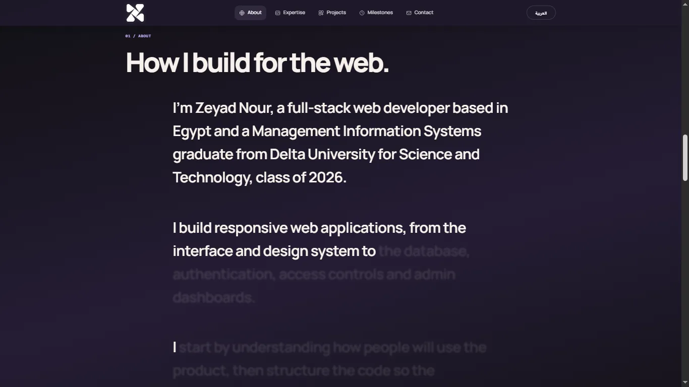
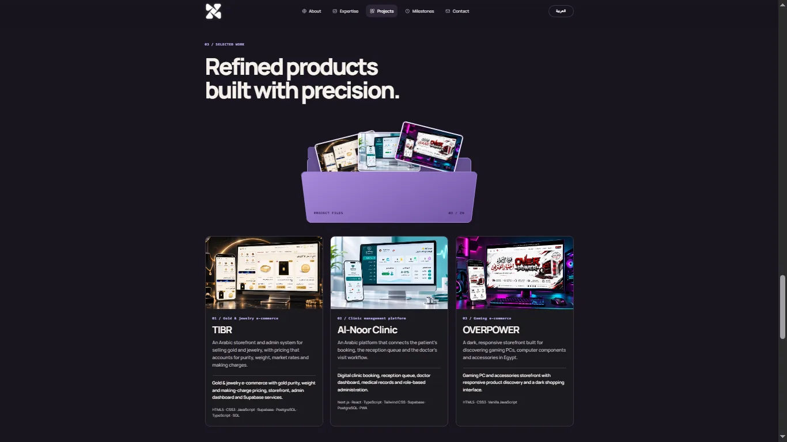

<div align="center">

# ZEYAD NOUR
### FULL-STACK WEB DEVELOPER · UI/UX FOCUSED

**A modern, bilingual portfolio built to make every detail count.**


[**Explore the Sections**](#-website-walkthrough) · [**Download Source**](#-download--run) · [**Deploy**](#-deploy-to-vercel) · [**Contact**](#-connect)

</div>

---

## ✦ The Experience

A carefully crafted personal portfolio presenting my work, skills, and approach to web development. The website combines **minimalist dark visuals**, **smooth motion**, **responsive layouts**, and **Arabic / English support**.

> **بالعربي:** ده الموقع الشخصي لزياد نور، بتصميم داكن ومتجاوب مع جميع الشاشات، وبدعم كامل للعربي والإنجليزي.

## 📸 Website Walkthrough

Explore the real sections of the website, from the opening hero to the final contact call to action.

### 01 / THE INTRODUCTION

**First impressions matter.**


A cinematic dark hero with a personal portrait, bold typography, and a clean navigation bar.

**بالعربي:** واجهة البداية بتعرض الصورة الشخصية والتعريف بالمطور، مع قائمة تنقل بسيطة وواضحة.

---

### 02 / ABOUT ME

**The story behind the work.**



An introduction to Zeyad Nour, his Management Information Systems background, and his approach to building web products.

**بالعربي:** نبذة عن المطور وخلفيته الدراسية وطريقته في بناء مواقع وتطبيقات الويب.

---

### 03 / EXPERTISE

**The tools behind the experience.**


A visual technology stack highlighting frontend, backend, databases, design, deployment, and security-related skills.

**بالعربي:** قسم المهارات والتقنيات المستخدمة في الواجهات وقواعد البيانات والتصميم والنشر.

---

### 04 / SELECTED PROJECTS

**Ideas turned into real interfaces.**



A curated gallery featuring TIBR, Al-Noor Clinic, and OVERPOWER, with previews and project descriptions.

**بالعربي:** عرض المشاريع الثلاثة بصور معاينة ووصف مختصر لكل مشروع.

---

### 05 / MILESTONES

**The journey and the process.**


Education milestones and a step-by-step workflow, from understanding requirements to deployment and refinement.

**بالعربي:** المسار الدراسي وخطوات تنفيذ المشاريع من التخطيط إلى الاختبار والنشر.

---

### 06 / CONTACT

**Let's build something together.**


A focused call to action that invites collaboration, with direct navigation to contact options.

**بالعربي:** قسم التواصل والتعاون لبدء مشروع جديد أو مناقشة فكرة.

---

## 🧩 Featured Projects

| Project | What it does | Website |
|:---|:---|:---|
| **TIBR / تِبر** | Gold and jewelry e-commerce storefront | [Visit project](https://tibr.kesug.com/) |
| **Al-Noor Clinic / عيادة النور** | Patient booking, reception queue, and doctor workflows | [Visit project](https://al-noor-clinic-six.vercel.app/) |
| **OVERPOWER** | Gaming PCs, components, and accessories storefront | Featured in the portfolio |

## ⚙️ Built With

**Portfolio website:** HTML5 · CSS3 · Vanilla JavaScript

**Skills and technologies featured:** React · Next.js · TypeScript · Node.js · Tailwind CSS · Supabase · PostgreSQL · Figma · Git · GitHub · Vercel

## 🗂️ Project Structure

```text
Portfolio/
├── index.html                    # Website entry point / الصفحة الرئيسية
├── assets/
│   ├── css/                      # Styling / التنسيقات
│   ├── js/                       # Animations & interactions / التفاعل
│   ├── images/                   # Images and logo / الصور
│   ├── fonts/                    # Fonts / الخطوط
│   └── icons/                    # Icons / الأيقونات
├── data/                         # Structured content / البيانات
├── docs/
│   └── screenshots/              # README gallery / صور الشرح
├── README.md
└── vercel.json                   # Vercel configuration
```

## 📥 Download & Run

**Download the full project:** [GitHub → Code → Download ZIP](https://github.com/szmff/Portfolio/archive/refs/heads/main.zip)

Or clone the repository:

```bash
git clone https://github.com/szmff/Portfolio.git
cd Portfolio
```

Open `index.html` in your browser, or start a local server:

```bash
python -m http.server 8000
```

Visit `http://localhost:8000`.

> **ملاحظة:** لازم ترفع ملفات الموقع كلها للمستودع، مش ملف README والصور بس، علشان زر التحميل يحمّل المشروع كاملًا.

## 🛠️ How to Customize / دليل التعديل

| Want to change / التعديل | Where / المكان |
|---|---|
| Text and page sections / النصوص والأقسام | `index.html` |
| Colors, sizes, layout / الألوان والأحجام | `assets/css/portfolio.css` |
| **Z logo size / حجم لوجو Z** | `.brand img` in `assets/css/portfolio.css` |
| Logo and project covers / صور المشاريع | `assets/images/` |
| Animations and interactions / الأنيميشن | `assets/js/` |
| README screenshots / صور الشرح | `docs/screenshots/` |

## ☁️ Deploy to Vercel

1. Open [vercel.com/new](https://vercel.com/new).
2. Import the **szmff/Portfolio** GitHub repository.
3. Select **Other** as the framework preset.
4. Set **Root Directory** to `./`.
5. Leave install and build commands empty, then click **Deploy**.

## 🤝 Connect

<div align="center">

**HAVE A PROJECT IN MIND?**

[GitHub](https://github.com/szmff) · [LinkedIn](https://eg.linkedin.com/in/zeyad-nour-108b86378) · [Email](mailto:zeyadnour68@gmail.com)

---

<sub>Designed & developed by <b>Zeyad Nour</b> · Egypt 🇪🇬</sub>

</div>

## 📄 License

The source is publicly viewable and downloadable. No open-source license is currently granted; contact the author before reusing or redistributing the code.
