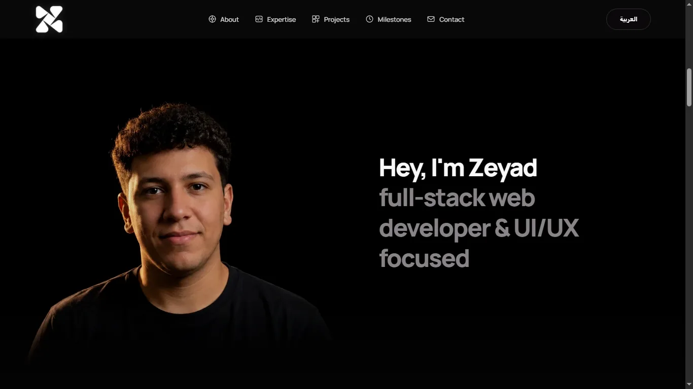
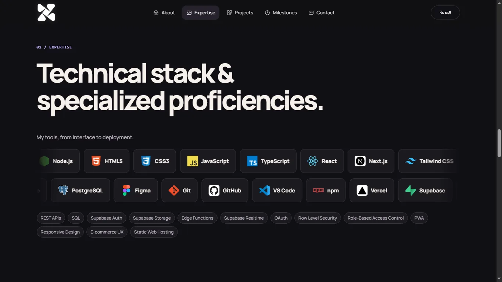
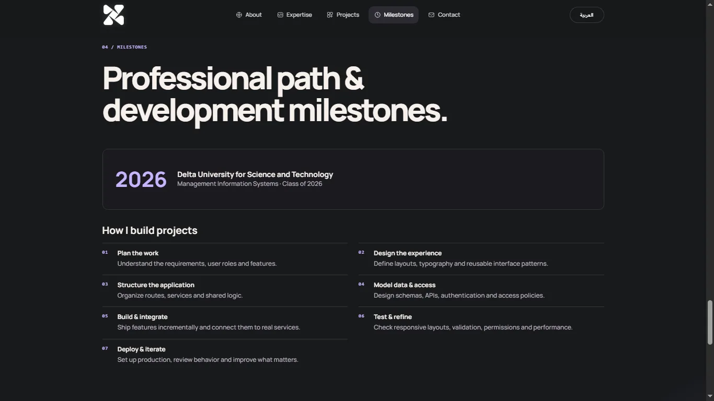
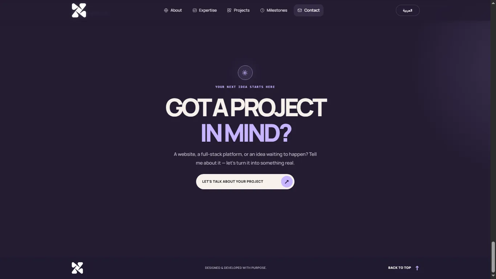

<div align="center">

# ZEYAD NOUR
### FULL-STACK WEB DEVELOPER · UI/UX FOCUSED

**Modern. Responsive. Bilingual. Built with purpose.**

   

[**Website Tour**](#-website-walkthrough) · [**Download**](#-download--run) · [**Vercel**](#-deploy-to-vercel) · [**Contact**](#-connect)

</div>

---

## ✦ The Experience

A personal portfolio built around minimalist dark visuals, expressive typography, smooth interactions, and fully responsive layouts.

**بالعربي:** الموقع الشخصي لزياد نور، بتصميم داكن ومتجاوب، وبدعم العربية والإنجليزية.

## 📸 Website Walkthrough

Six real screenshots from the website, each with an explanation in English and Arabic.

### 01 / HERO — FIRST IMPRESSION



A bold personal introduction with a cinematic portrait, dark styling and navigation.

**بالعربي:** مقدمة الموقع: الصورة الشخصية، التعريف بالمطور، والقائمة الرئيسية.

---

### 02 / ABOUT — MY STORY


An introduction to my background, education and approach to web development.

**بالعربي:** نبذة عني وخلفيتي الدراسية وطريقتي في تنفيذ المشاريع.

---

### 03 / EXPERTISE — TECH STACK



Frontend, backend, database, design and deployment tools presented in a visual grid.

**بالعربي:** قسم المهارات والتقنيات المستخدمة في التطوير والتصميم والنشر.

---

### 04 / PROJECTS — SELECTED WORK


A showcase of TIBR, Al-Noor Clinic and OVERPOWER, with project previews and descriptions.

**بالعربي:** معرض المشاريع الثلاثة مع صور المعاينة ووصف كل مشروع.

---

### 05 / MILESTONES — MY JOURNEY



Education milestones and a structured development workflow, from planning to deployment.

**بالعربي:** المسار الدراسي ومراحل بناء المشاريع من التخطيط حتى النشر.

---

### 06 / CONTACT — LET'S COLLABORATE



A clear invitation to collaborate on websites, platforms and digital products.

**بالعربي:** قسم التواصل لبدء مشروع أو مناقشة فكرة جديدة.

---

## 🧩 Featured Projects

| Project | Description | Live |
|---|---|---|
| **TIBR / تِبر** | Gold and jewelry storefront | [Visit](https://tibr.kesug.com/) |
| **Al-Noor Clinic / عيادة النور** | Booking, reception queue, and doctor workflow | [Visit](https://al-noor-clinic-six.vercel.app/) |
| **OVERPOWER** | Gaming PCs and accessories storefront | Portfolio preview |

## 🛠️ Built With

**Portfolio:** HTML5 · CSS3 · Vanilla JavaScript

**Skills showcased:** React · Next.js · TypeScript · Node.js · Tailwind CSS · Supabase · PostgreSQL · Figma · Git · Vercel

## 📂 Project Structure

```text
Portfolio/
├── index.html
├── assets/
│   ├── css/          # Styles / التنسيقات
│   ├── js/           # Animations / الأنيميشن
│   ├── images/       # Images / الصور
│   ├── fonts/
│   └── icons/
├── data/
├── docs/
│   └── screenshots/  # README gallery / صور الشرح
├── README.md
└── vercel.json
```

## 📥 Download & Run

[**Download ZIP from GitHub**](https://github.com/szmff/Portfolio/archive/refs/heads/main.zip) — downloads everything currently uploaded to the repository.

```bash
git clone https://github.com/szmff/Portfolio.git
cd Portfolio
python -m http.server 8000
```

Open **http://localhost:8000**. You can also open `index.html` directly.

**مهم:** ارفع ملفات الموقع للمستودع علشان التحميل يشمل المشروع كاملًا.

## ✏️ Editing Guide / دليل التعديل

| What to change / التعديل | File / الملف |
|---|---|
| Page content / النصوص | `index.html` |
| Colors and layout / الألوان والتصميم | `assets/css/portfolio.css` |
| Z logo size / حجم لوجو Z | `.brand img` in `assets/css/portfolio.css` |
| Images / الصور | `assets/images/` |
| Animations / الأنيميشن | `assets/js/` |
| README screenshots / صور الشرح | `docs/screenshots/` |

## ☁️ Deploy to Vercel

1. Open [Vercel](https://vercel.com/new) and import `szmff/Portfolio`.
2. Choose **Other** for framework preset.
3. Keep the root directory `./`; no build or install commands required.
4. Click **Deploy**.

## 🤝 Connect

<div align="center">

**GOT A PROJECT IN MIND?**

[GitHub](https://github.com/szmff) · [LinkedIn](https://eg.linkedin.com/in/zeyad-nour-108b86378) · [Email](mailto:zeyadnour68@gmail.com)

**Designed & developed by Zeyad Nour · Egypt 🇪🇬**

</div>

## 📄 Usage

The source is publicly viewable and downloadable. No open-source license is currently granted; contact the author before reusing or redistributing the code.
